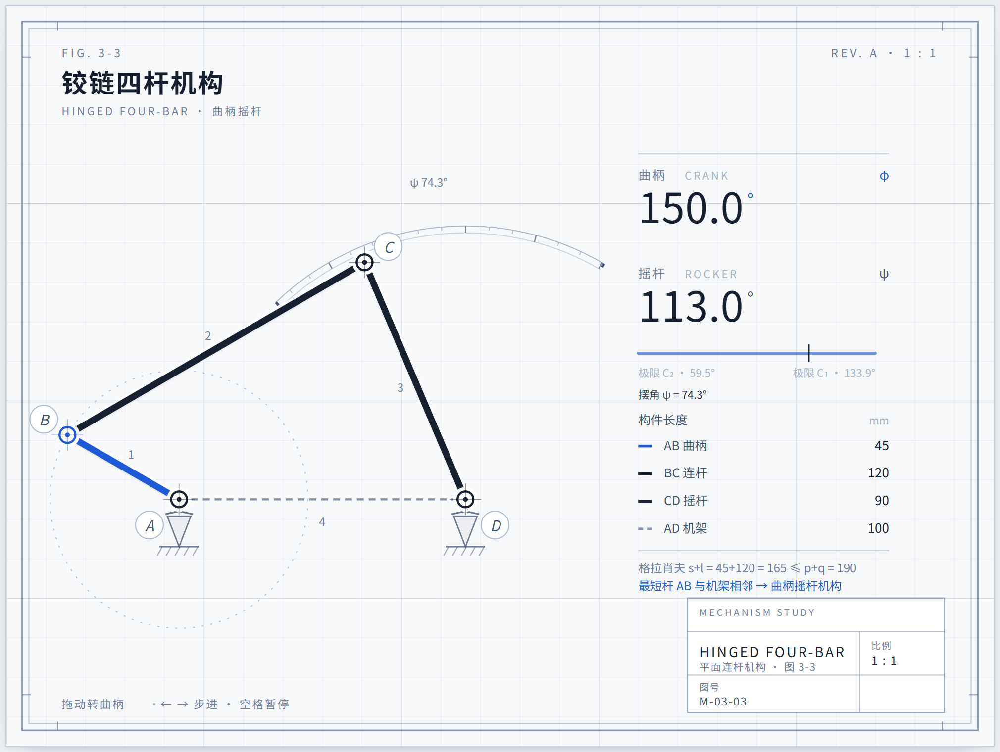
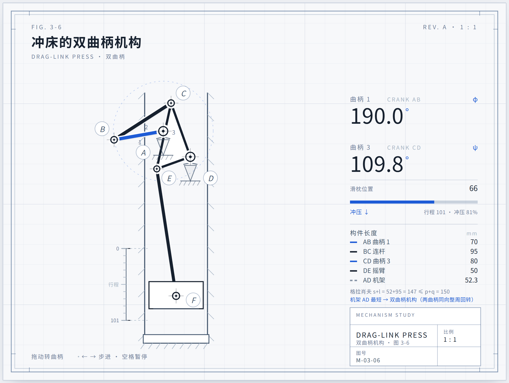
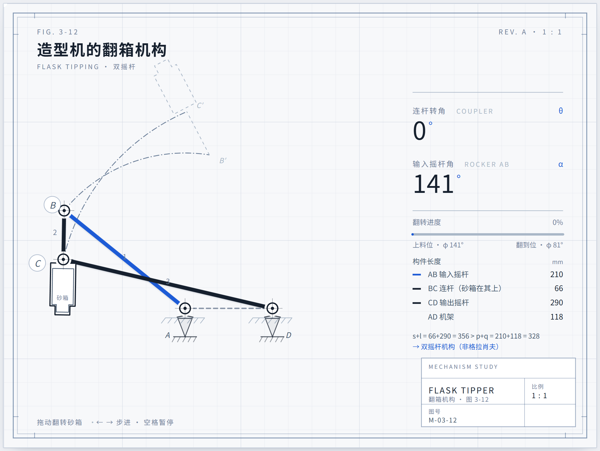

# blueprint-mechanism-figs

> 把《机械原理》教材里的静态平面连杆机构图，做成**可拖动的二维白纸蓝图**示意图。
> 先算后画：机构类型、装配模式、可达区间、扫掠角、刚体不变量必须验算并打印，**验算不过就不画**。

一个 [DeepSeek Harness](https://github.com/) 技能（skill），也可以脱离 DSH 单独当 Node 库用。



| 图 3-6 冲床的双曲柄机构 | 图 3-12 造型机的翻箱机构 |
|---|---|
|  |  |

> 图 3-12 是**原图对齐**的样例：杆长从教材原图（`mechanism-principles-4e` 的 `docs/images/…jpg`）量点折算，AB 210 / BC 66 / CD 290 / AD 118，`s+l = 356 > p+q = 328` → 双摇杆；教材写「翻转 180°」，按这套杆长实算两个所示位形之间连杆转过 **149°**，差异写进了图注（见 SKILL §3.3）。

---

## 它解决什么问题

教材上的连杆机构图是静态的，读数靠想象；用等轴测（isometric）画又会把平面机构画歪、判不出装配模式。这个技能用**工程制图（白纸蓝图）**的二维画法：

- 米白纸 + 细网格 + 双线图框 + 右下标题栏 + 等宽数字读数，一张图就是一张图纸；
- 杆件真实长度、真实角度，机构判据（格拉肖夫）**印在图上**而不是嘴上说；
- 鼠标拖动 / `←→` / `Home` / `End` 驱动，读数与运动同源；
- 每个图自带一个**命令行体检**，机构不合法就不出图。

## 八条物理契约（技能的核心）

从 `anatomy` 技能的实体规则翻译而来，画图前必须逐条过：

1. **先判型**——格拉肖夫 `s+l ≤ p+q`；最短杆是机架→双曲柄、是连架杆→曲柄摇杆、是连杆→双摇杆。这条决定"能不能翻 180°"：只有双曲柄的连杆在一个周期里转过 360°。
2. **锁死装配模式**——`side` 固定，相邻帧跳变 > 90° 就是换支了。
3. **输入 = 可达集**——拖动、方向键、`End` 全部 clamp，不许拖出画面。
4. **扫掠表先行**——无解帧、跳变、连杆累计转角、最小间距、包围盒，声称的角度必须从表里读。
5. **刚体不变量**——杆长 / 矩形边长任意两帧恒定（±0.05 px）；忽大忽小只有三种成因：缩放乘两遍、四角各算、每帧重拼。
6. **铰必须真铰**——杆端必须落在销钉或接地支座上；要随连杆转的矩形，只有"两真铰"或"固结"两种合法画法。
7. **实体件不被杆穿过**——箱体两端各有铰 → 箱体就是连杆；箱体是外挂件 → 两铰必须落在同一条边上。
8. **数即模型**——读数、行程、速度同源，速度用解析差分。

## 快速开始

需要 Node ≥ 18，无第三方依赖。

```bash
# 1) 体检：杆长 → 机构类型 + 扫掠统计 + 刚体校验
node check.mjs 45 120 90 100
#    判定  s+l = 45+120 = 165 ≤ p+q = 190  →  曲柄摇杆机构（最短杆为连架杆）
#    · 无解帧 0/361 · 换支跳变 1.04° · 杆长偏差 4.3e-14 mm
#    · 摇杆摆角 ψ 59.5°…133.9°（摆角 74.3°）· 杆件最小间距 55.0 mm
#    ✓ 硬性三项通过，可以开始画

# 2) 跑样例：生成一张 4:3 的自包含 HTML
node example-fig-3-3.mjs      # → example-fig-3-3.html
```

浏览器打开 `example-fig-3-3.html`：拖动转曲柄，`←→` 步进 5°，`Home/End` 到极限，空格暂停。

## 目录

```
SKILL.md              技能本体（DSH 用；顶部 front matter 是注册信息）
bp.mjs                版式库：网格、双线图框、标题栏、销钉、接地、杆件白底衬、读数、页面、驱动
mech.mjs              求解器：classify / solve4 / poseByCoupler / sweep4 / rigidCheck
check.mjs             命令行体检（exit 1 = 不合格）
example-fig-3-3.mjs   完整可跑的样例（曲柄摇杆）
example-fig-3-12.mjs  原图对齐样例（教材图 3-12 翻箱机构，杆长由原图量点折算）
```

### API 速查

```js
import { classify, sweep4, rigidCheck, solve4, poseByCoupler } from "./mech.mjs";

const L = { a: 45, b: 120, c: 90, d: 100 };   // AB 曲柄 / BC 连杆 / CD 摇杆 / AD 机架
classify(L);
// → { s, l, pq, sum, grashof, kind: "crank-rocker", cn: "曲柄摇杆机构（最短杆为连架杆）" }

sweep4(L, +1, 360);
// → { frames, bad, psiMin, psiMax, swing, couplerSweep, maxJump, minGap, bbox }

rigidCheck(L, +1, 72);   // → { worst, ok }
solve4(L, phiDeg, +1);   // 曲柄驱动：给定曲柄角 → { A,B,C,D, alpha, psi }
poseByCoupler(L, thDeg, +1); // 连杆驱动：给定连杆方向（双曲柄翻载物时用这个）
```

```js
import * as B from "./bp.mjs";
B.page({ title, body, script, caption, w: 1000, h: 750 }); // 1000×750 的图纸页
B.grid / frameBox / header / titleBlock / hint / pin / support / tag /
B.linkLines / readout / row / driver;
```

## 装成 DSH 技能

把整个目录放到 `<DSH_HOME>/skills/` 下（保持文件夹名 `blueprint-mechanism-figs`、保留 `SKILL.md` 顶部的 `name/description`），重开会话即可在技能列表里看到它。

## 常见问题

**`git push` 报 `Recv failure: Connection was reset` 或 `Failed to connect to github.com:443 over proxy`**

八成是代理配置，按顺序查：

```bash
git config --get http.proxy          # 全局代理端口对不对（Clash 常见 7890 / 12000，换端口后要跟着改）
git config --local --get http.proxy  # 关键：仓库里若有一条空的 ""，它是"显式不用代理"，会压掉全局设置
```

- 端口变了：`git config --global http.proxy http://127.0.0.1:<新端口>`（https.proxy 同理）。
- 仓库里残留空值：`git config --local --unset http.proxy`，再 `git fetch`。
- 只想临时绕过：`git -c http.proxy=http://127.0.0.1:<端口> push`。

**确认是"网络"还是"配置"**：`curl -x http://127.0.0.1:<端口> -o /dev/null -w "%{http_code}\n" https://api.github.com`。返回 200 说明代理通，问题一定在 git 配置上。

**`github.com` 连不通但 `api.github.com` 通**：可以先用 GitHub 的 Git Data API（blob → tree → commit → 更新 ref）把提交推上去应急，等网络恢复再 `git fetch && git reset --hard origin/main` 对齐。

## 反模式（真踩过的坑）

| 别这么干 | 会怎样 |
|---|---|
| 用双摇杆硬凑 180° 翻转 | 连杆只能摆有限角度，中途一定"折"在一起 |
| 矩形尺寸乘了两遍缩放 | 箱子随姿态忽大忽小，看着像平行四边形 |
| 拖动不 clamp | 能拖到 171% / 309°，机构飞出画面 |
| 读数用常数、图形用参数 | 数字漂亮但和画面对不上（违反"数即模型"） |
| 两根连杆 + 一整块箱体 | 二维里 0 自由度（过约束），真机靠柔性或分层实现 |
| 靠重排图层掩盖穿模 | 杆件从箱体里"长"出来，一眼假 |

## 许可

MIT。作者 [@Nitgomare](https://github.com/Nitgomare)。
